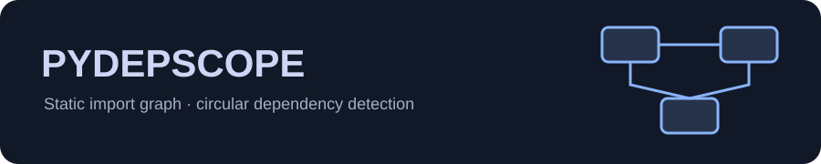

<div align="center"><h1>PyDepScope</h1><p>Understand a Python codebase without importing or executing it.</p></div>

## Features
- AST-based static import discovery.
- Local module dependency graph and external import roots.
- Circular import cycle detection.
- Mermaid diagram and JSON exports.
- Skips virtual environments, build output and dependency folders.

## Run
```bash
python app.py ./src
python app.py . --json
python app.py . --mermaid dependencies.mmd
```
Python 3.9+, standard library only. Analysis is static: dynamic imports and runtime-generated module paths cannot always be resolved.

## Tests
```bash
python -m unittest discover -s tests -v
```
MIT License.